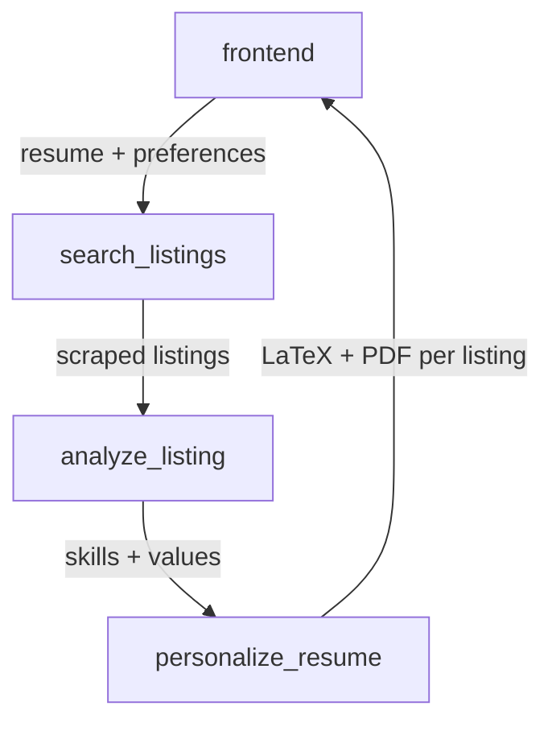

# Internship application automation tool

An agentic pipeline that finds internship listings, works out what each
employer is looking for, and hands back a resume personalized for that
listing — as both a PDF and its LaTeX source.



There is no automated submission step. Apply forms differ too much
listing-to-listing to automate reliably, so the pipeline stops at the
personalized resume and you submit it yourself. See [planning.md](planning.md)
and [TOOLS.md](TOOLS.md) for the design, and each service's README for its API.

## Quick start (Docker)

Requires Docker with Compose v2 (`docker compose`, not the old
`docker-compose` script) and a free [Groq API key](https://console.groq.com/keys).

**1. Configure.**

```bash
cp .env.example .env    # then fill in GROQ_API_KEY
```

**2. Log into Handshake — once.**

The scraper never types your password. You log in by hand and it saves the
session for reuse. Since your school's SSO and MFA need a browser a human can
actually see, this container starts one on a virtual display and streams it to
your host:

```bash
docker compose run --rm --service-ports auth
```

Open <http://localhost:7900/vnc.html?autoconnect=1&resize=scale>, log in there
until you reach your Handshake dashboard, then press **Enter** back in the
terminal. The session is written to `services/search_listings/.auth/`
(gitignored) and mounted read-only into the scraper.

**3. Start everything.**

```bash
docker compose up --build
```

Then open <http://localhost:3000>. Paste your resume's LaTeX source, describe
what you're looking for in plain text, and hit **Find listings**.

The first build takes several minutes — it downloads Chromium and pre-warms
Tectonic's LaTeX package cache so your first resume compile isn't slow. Later
builds are cached.

## What's running

| Service              | Port | Role                                                      |
| -------------------- | ---- | --------------------------------------------------------- |
| `frontend`           | 3000 | UI, and the orchestrator that calls the three services     |
| `search_listings`    | 8001 | Playwright scrape of Handshake                             |
| `analyze_listing`    | 8002 | Groq call — extracts the skills/values a listing wants     |
| `personalize_resume` | 8003 | Groq call to edit the LaTeX, then Tectonic compile to PDF  |
| `auth`               | 7900 | One-shot login capture; not started by `up`                |

The backend ports are published mainly so you can `curl` them directly while
debugging — the frontend reaches them over the compose network by service name.

Scraped listings and their analyses persist in `data/app.db`, bind-mounted from
the repo root, so they survive `docker compose down`.

## Troubleshooting

**A run fails immediately at "Searching listings".** The saved Handshake session
expired — sessions don't last forever. Re-run step 2. You can confirm with
`curl localhost:8001/health`, which reports whether a session file is present.

**`analyze_listing` or `personalize_resume` sits at "starting" and the frontend
never comes up.** Their health checks assert `GROQ_API_KEY` is set, so this is
almost always a missing or empty key in `.env`. Re-running `docker compose up`
after fixing it is enough.

**A listing fails at the personalize step with a Tectonic error.** The model's
LaTeX edits didn't compile. That failure is deliberate and per-listing — the run
continues with the rest — but it does mean no PDF for that one.

**Linux hosts:** containers run as UID 1000, so `data/` and
`services/search_listings/.auth/` need to be writable by that UID. If your login
user isn't 1000, `chown -R 1000:1000 data services/search_listings/.auth`.

## Running without Docker

Each service has its own README covering a local venv, its dependencies, and
`uvicorn` command — see
[search_listings](services/search_listings/README.md),
[analyze_listing](services/analyze_listing/README.md),
[personalize_resume](services/personalize_resume/README.md), and
[frontend](services/frontend/README.md). That path needs Python 3.12, Node 22,
and [Tectonic](https://tectonic-typesetting.github.io/) on your PATH.

## A note on deployment

This setup is deliberately single-machine and single-user: the three backend
services share one SQLite file over a bind mount, and the Handshake session is
one file on disk that every request reads. Both assumptions break the moment
this is hosted for more than one person — and storing other people's university
SSO session cookies is a materially different proposition from keeping your own
on your own laptop. Run it locally.
